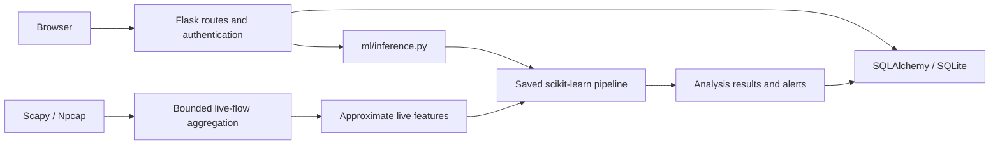

# 🛡️ CyberShield AI

**AI-Based Cybersecurity Threat Detection and Monitoring System**

CyberShield AI is a web-based cybersecurity platform developed as a **BCA Final-Year Project**. It combines **machine-learning analysis of CIC-IDS2017 flow records, live packet capture, and alert management** to help investigate suspicious network activity.

## 🚀 Key Features

- 🔐 User registration, login and secure authentication
- 🤖 AI/ML-based network threat detection
- 📊 CIC-IDS2017 dataset analysis
- 🌐 Live network packet monitoring using Scapy
- 🚨 Automated security alerts
- ⚠️ Threat severity and risk assessment
- 📈 Security dashboard and analytics
- 📄 Security reports
- 🗄️ SQLite database for users, analyses and alerts
- 🛡️ CSRF protection and password hashing

## 🧠 Machine learning and evaluation

The bundled multiclass Random Forest expects **77 CIC-IDS2017 flow features**. Training first reserves one complete source CSV to evaluate a model trained on the other files, then fits the saved production model on all available labeled files. The report distinguishes the holdout evaluation from final-model training and includes accuracy, balanced accuracy, macro/weighted F1, per-class precision/recall/F1/support, and a labeled confusion matrix.

After training, inspect [`models/model_evaluation.json`](models/model_evaluation.json). This grouped, same-corpus holdout is a better check against capture-day leakage than a random row split, but it is **not external validation**. Class-wise sampling caps mean weighted metrics do not represent natural network prevalence. The report lists any labels absent from the holdout or training data; it does not prove performance on unseen networks, modern traffic, or attack variants.

The current report specifically shows `FTP-Patator` and `SSH-Patator` in the holdout but not in the evaluation model's training split. The final model includes examples of those labels, but this holdout does not validate whether it generalizes to them. Its high accuracy is driven by the benign-heavy holdout and must not be presented as evidence of reliable attack detection. Validate against independent, labeled captures before making that claim.

The UI's `predict_proba` values are **uncalibrated model scores**, not calibrated probabilities that an incident is malicious. Severity is a prioritization heuristic. Treat detections as investigation leads, not confirmed incidents.

The training script reads CIC-IDS2017 CSVs from `datasets/`. The large dataset files are intentionally not committed; obtain the dataset from its authorized source before retraining. The default holdout file must be present. To choose another source file, set `CYBERSHIELD_HOLDOUT_FILE` to its exact filename before running training.

```powershell
.\.venv\Scripts\python.exe -m ml.train_model
```

Print the saved summary with:

```powershell
.\.venv\Scripts\python.exe -m ml.show_model_evaluation
```

## 🌐 Live monitoring

Live monitoring uses Scapy and Npcap (Windows), in-memory aggregation capped at 500 active flows with bounded packet samples, and the same model for experimental live inference. Start the app with packet-capture permissions and select the adapter carrying the traffic. Packet capture availability and ML inference availability are separate: the UI reports capture failures and inference errors independently.

Raw packets are not directly passed to the CIC-IDS2017 model. Live flow features are approximations derived from observed packets and are **not equivalent to CICFlowMeter output**. Live inference should therefore be treated as experimental until validated against representative labeled packet captures. Do not monitor networks without authorization.

## 🛠️ Technology Stack

| Technology | Purpose |
|---|---|
| Python | Backend & ML |
| Flask | Web framework |
| Flask-SQLAlchemy | Database |
| Flask-Login | Authentication |
| Scapy | Network monitoring |
| Scikit-learn | Machine Learning |
| Waitress | Windows production WSGI server |
| Pandas / NumPy | Data processing |
| SQLite | Database |
| HTML / CSS / JavaScript | Frontend |
| Npcap | Packet capture |

## 🧭 Architecture



Batch CSV analysis and live capture share the saved model, but live packet-derived features are a separate approximation path and need their own validation.

## 📁 Project Structure

```text
CyberShield-AI/
├── app.py
├── extensions.py
├── requirements.txt
├── ml/
│   ├── evaluation.py
│   ├── inference.py
│   ├── show_model_evaluation.py
│   ├── train_model.py
├── tests/
├── models/
│   ├── cybershield_model.joblib
│   └── model_evaluation.json
├── templates/
├── static/
├── datasets/
└── README.md
```

## ▶️ Run locally (Windows)

1. Install **Python 3.11 or later** and Git. Clone the repository (you must have access to this private repository):

   ```powershell
   git clone https://github.com/Yugank587/CyberShield-Ai.git
   cd CyberShield-Ai
   ```

2. Create a virtual environment and install the dependencies:

   ```powershell
   py -m venv .venv
   .\.venv\Scripts\Activate.ps1
   python -m pip install -r requirements.txt
   ```

   If PowerShell blocks activation, use the virtual environment's Python directly:

   ```powershell
   .\.venv\Scripts\python.exe -m pip install -r requirements.txt
   ```

3. Create your local settings file:

   ```powershell
   Copy-Item .env.example .env
   ```

   Local development generates a temporary secret if the example placeholder is unchanged (sessions will be invalidated when the app restarts). For production, set `APP_ENV=production` and replace `SECRET_KEY` with a persistent random value. You can generate one with:

   ```powershell
   python -c "import secrets; print(secrets.token_hex(32))"
   ```

4. Run automated tests:

   ```powershell
   .\.venv\Scripts\python.exe -m unittest discover -s tests -v
   ```

5. Start the development app:

   ```powershell
   python app.py
   ```

   If you skipped activation, run `.\.venv\Scripts\python.exe app.py` instead.

6. Open **http://127.0.0.1:5000** in your browser and register an account.

The app creates its local SQLite database automatically. For live packet monitoring on Windows, install **Npcap** with **WinPcap API-compatible Mode** and run the app with the permissions required to capture traffic. On the Live Monitor page, select the adapter actually carrying traffic. The CIC-IDS2017 CSV files are not included; add them to `datasets/` if you want to retrain the model.

## 🚀 Production deployment

The built-in Flask development server is for local development only. On Windows, install the declared Waitress dependency and run behind a TLS-terminating reverse proxy. Generate a secret once, store it securely, and configure that same value in the service environment before each start:

```powershell
python -c "import secrets; print(secrets.token_hex(32))"
```

```powershell
$env:APP_ENV = "production"
$env:DATABASE_URL = "sqlite:///cybersecurity.db"
waitress-serve --listen=127.0.0.1:5000 app:app
```

Set the `SECRET_KEY` environment variable from your secret manager; do not regenerate it on every start. Keep the application bound to localhost behind the proxy, enable HTTPS there, and back up the database. Production mode refuses missing, short, or known placeholder secrets and marks session cookies `Secure`, `HttpOnly`, and `SameSite=Lax`. The app adds baseline browser security headers; review them and the reverse-proxy configuration before public exposure. SQLite is appropriate for a local/demo deployment; choose and configure a managed database for multi-user production workloads.

## 🧪 Test coverage

The standard-library `unittest` suite checks authentication and redirect behavior, authorization boundaries, security headers, monitor capture errors, configuration safeguards, model feature compatibility, and metric reporting. It does not replace end-to-end testing against real labeled PCAPs or security review.

## 🎓 Project Purpose

CyberShield AI demonstrates how **Artificial Intelligence and Network Security** can be combined to build a cybersecurity monitoring prototype for investigating potential network threats.

## 🔮 Future Enhancements

- Advanced threat intelligence
- Improved real-time ML detection
- Automated incident response
- Advanced network analytics
- Audit logging
- User profile and system settings
- Dark/Light theme
- Advanced security reports
